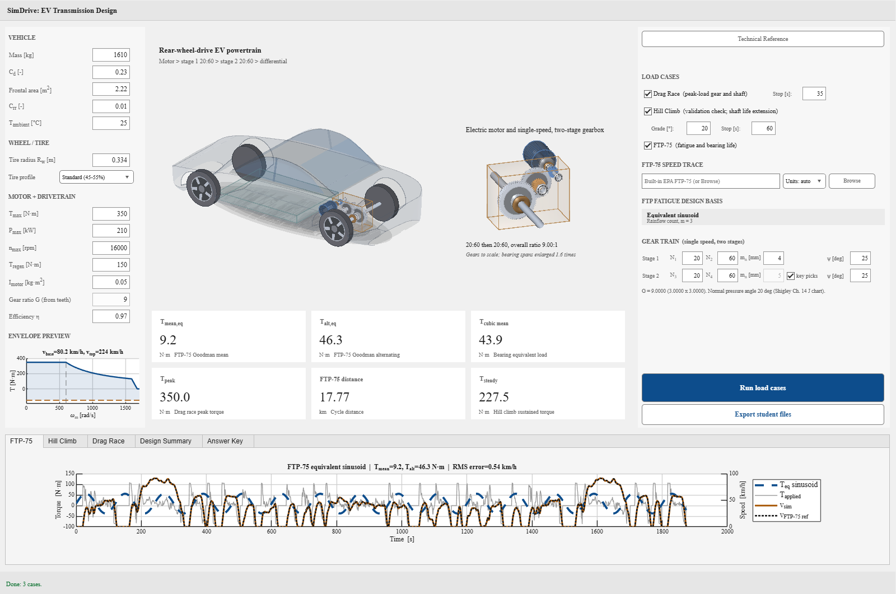
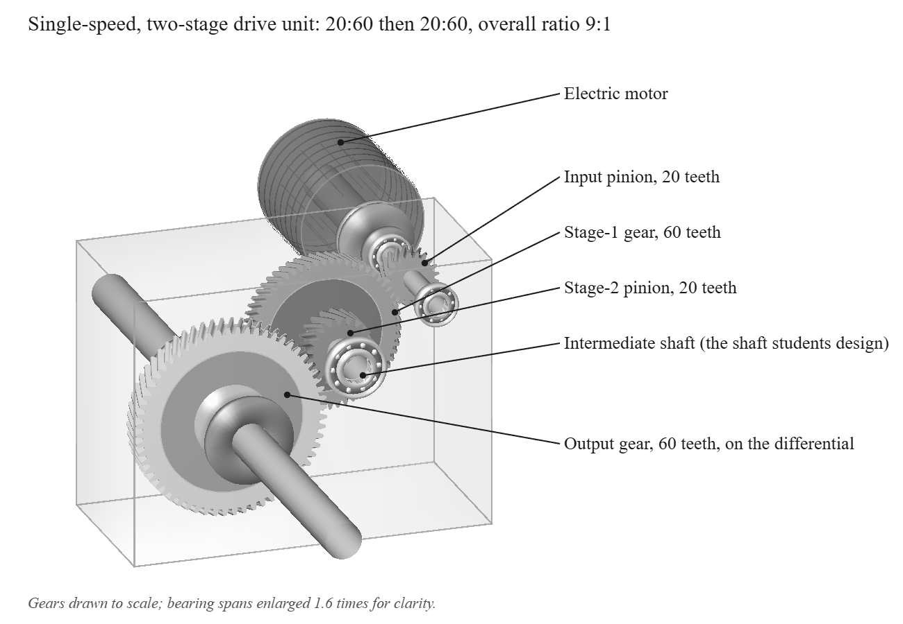
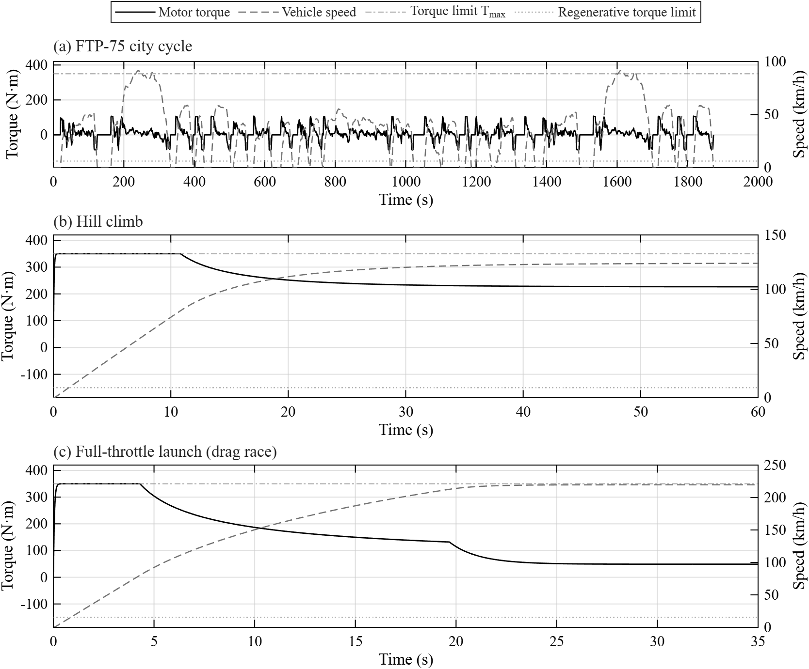

# SimDrive: EV Transmission Design
*Shigley-based gearbox design for a passenger EV, driven by Simulink load cases*

[](https://www.mathworks.com/products/matlab.html)
[](LICENSE)

SimDrive is a machine design project for third- and fourth-year mechanical
engineering students, based on *Shigley's Mechanical Engineering Design*, 11th
edition. Students perform the AGMA rating of two helical gear stages, the
fatigue and yield design of a stepped shaft, and the selection of deep-groove
ball bearings from a manufacturer's catalog. The loads are obtained from a
MATLAB and Simulink model of the vehicle in three load cases: a full-throttle
launch (the drag race case), the EPA FTP-75 city cycle and a sustained hill
climb.

The worked answer key is not included in this repository. Instructors may
request it by email, as described in [The reference
solution](#the-reference-solution).



*The instructor dashboard with the answer key extracted. Without the key, the
"key picks" option is disabled and the Answer Key tab remains empty.*

## Quick start

```matlab
% In MATLAB, from the repository folder
cd instructor
Start_Here            % checks the installation and opens the dashboard
```

In the dashboard, retain the default values or enter a different vehicle and
gear train, select **Run load cases** (approximately two minutes for all three
cases on a desktop computer), and then select **Export student files**. Students
receive either the `student_package/` folder or the ZIP archive that the
dashboard writes to `release/`. For the default vehicle, the same archive is
attached to the [v1.0.0
release](https://github.com/ahmedibrahim-aus/SimDrive-EV-transmission/releases/tag/v1.0.0).
The package contains the project brief, the four templates, the simulation data
and the student documents. The worked solution is not included.

The vehicle mass, drag and tire data, the motor torque, power and speed limit,
and the tooth numbers, modules and helix angles of both stages are all user
inputs. The dashboard rejects a gear train outside the range of the Shigley
charts and states the reason.

Alternatively, from the command line, run `generateLoadCases` in `instructor/`
(this function clears the base workspace) and then `buildStudentPackage`.
Further details are given in [`docs/QUICKSTART.md`](docs/QUICKSTART.md) and the
[instructor guide](docs/INSTRUCTOR_GUIDE.md).

## Requirements

The instructor tools require MATLAB R2025b or newer, Simulink and the Signal
Processing Toolbox (for rainflow counting). Students require only MATLAB R2025b
or newer, with no toolboxes. The project has been tested with R2025b and R2026b
on Windows and has not yet been tested in MATLAB Online. On a new installation,
run `check_dependencies` in `instructor/`. Chapter references follow the 11th
edition of *Shigley's Mechanical Engineering Design*.

## Overview of the EV system

| Item | Value |
|---|---|
| Vehicle | Rear-wheel-drive passenger EV, 1610 kg, C<sub>d</sub> 0.23, frontal area 2.22 m², tire radius 0.334 m |
| Motor | 350 N·m peak torque, 210 kW, 16,000 rpm speed limit (base speed 80 km/h, 224 km/h at the speed limit) |
| Transmission | Single speed, two helical stages, 20:60 then 20:60, overall ratio 9:1, 20° normal pressure angle |
| Student design scope | Both gear meshes, the intermediate shaft that carries them, and its two bearings |
| Design life | 150,000 km |
| Targets | AGMA `S_F` ≥ 1.5 (bending), `S_H` ≥ 1.2 (contact); shaft factors of safety `n_f`, `n_y` ≥ 1.5 at every critical section |



## Educational contribution

Each design torque is obtained from the vehicle model and governs a different
failure mode, and the selection of the appropriate torque is part of the design
task. The launch provides the peak torque for the gear tooth rating and the
static yield check. The city cycle, reduced by rainflow counting, provides the
mean and alternating torques for the DE-Goodman shaft check and the cubic-mean
torque for the bearing rating life (Shigley, Chapter 11). The hill climb
provides a steady torque, which students first use to verify the simulation by
hand calculation.

The hill climb is a synthetic, power-limited case. Its angle, 20 degrees by
default (a 36.4 percent grade), is steeper than any public road and was selected
so that the motor operates at its power limit and the steady torque has a
closed-form solution. Students are required to demonstrate that their force
balance agrees with the simulated value to within one percent before using any
value from the model.

The templates and the reference solution follow the procedures of Shigley's 11th
edition, chapter by chapter, with the course approximations stated in the
[assignment scope](student/ASSIGNMENT_BRIEF.md#scope-and-limitations). Students
report the respects in which a design that satisfies the course checks does not
meet the requirements of a production transmission.

The answer key reflects the choices of the instructor. When the tooth numbers,
modules, helix angles or vehicle parameters are changed, the dashboard
recomputes the reference solution for that gear train. Different sections or
academic years can therefore receive different values from the same project.



## Mathematical model

The vehicle is modeled in Simulink as a point mass moving along a straight road.
Newton's second law balances the tractive force at the rear wheels against
rolling resistance, aerodynamic drag and the grade force. For the motor driving
the vehicle, the equation of motion is

```math
m_\text{eff}\,\frac{dv}{dt} = \frac{\eta\,G\,T_m}{R_w} - C_{rr}\,m\,g - \frac{1}{2}\,\rho\,C_d\,A\,v^2 - m\,g\sin\theta
```

The effective mass $m_\text{eff}$ adds the inertia of the motor rotor and the
four wheels, reflected through the overall ratio $G$ and the tire radius $R_w$.
The drivetrain efficiency $\eta$ is a constant 0.97 for the two meshes, and the
air density $\rho$ follows from the ambient temperature, pressure and humidity.
The motor torque $T_m$ is limited to the peak torque up to base speed and to
constant power above it, and it decreases to zero immediately below the speed
limit. On the city cycle a discrete PID controller follows the FTP-75 speed
schedule, and its torque command passes through an actuator lag, a rate limiter
and the motor envelope before it reaches the vehicle. Below 10 km/h, braking is
transferred from the motor to the friction brakes, which do not load the
gearbox. The launch and the hill climb are simulated at full throttle without a
controller. The electrical dynamics of the motor are not modeled, since their
time constants are of the order of a few milliseconds. Tire slip and thermal
derating are also neglected, and the exported torques are therefore upper bounds
on the loads that the gearbox would experience.

## Summary of methods

The torque histories are reduced on the instructor side before they are
distributed to students. The city cycle is rainflow counted (ASTM E1049), the
small cycles caused by controller ripple are discarded, and the remaining cycles
are combined by the Palmgren-Miner rule into one equivalent sinusoid, defined by
a mean torque and an alternating torque that produce the same fatigue damage as
the full history. The bearings use a different quantity, the cubic mean of the
torque weighted by shaft revolutions, which is the Shigley equivalent load for a
load that varies over the life of a bearing.

With these torques, students apply the Shigley procedures chapter by chapter.
The motor torque is transmitted to the intermediate and output shafts through
the stage ratios, and the tangential, radial and axial forces at each mesh
follow from the pitch diameter, the pressure angle and the helix angle (Chapter
13). Both stages are rated for tooth bending and surface contact with the AGMA
equations and their rating factors (Chapter 14). The intermediate shaft is
analyzed as a simply supported beam in two planes, including the couples from
the two helix thrusts. Each critical section is checked for fatigue with the
DE-Goodman equation and for first-cycle yield with the von Mises stress
(Chapters 3, 5, 6 and 7), with the shoulder stress-concentration factors read
from the Appendix A charts. The bearings are then selected from a catalog by
their equivalent radial load and an L<sub>10</sub> rating life of 150,000 km
(Chapter 11). The equations, default parameters and their sources are given in
full in [`docs/MathematicalModels.md`](docs/MathematicalModels.md).

## Coverage of Shigley

| Shigley 11e chapter | Topic | Application in the project |
|---|---|---|
| 3 | Reactions, shear force and bending moment diagrams in two planes | Intermediate shaft |
| 5 | Distortion-energy theory for static failure | Shaft yield at the peak torque |
| 6 | Endurance limit, Marin factors, notch sensitivity, modified Goodman, S-N line | Shaft fatigue; finite life as an extension |
| 7 | Stepped shaft layout, critical sections, the DE-Goodman shaft equations | Intermediate shaft |
| 11 | Equivalent radial load and its factors, variable loading, L<sub>10</sub> rating life | Bearing selection |
| 13 | Helical gear geometry, force analysis, helix hand on a common shaft | Both gear stages and the shaft loads |
| 14 | AGMA bending and contact stress, every rating factor | Both gear stages |
| Appendix A | Stress-concentration charts, heat-treated steel properties | Shaft shoulders and materials |

## Student tasks

1. Load the data (`Student_01`). Match each torque to the failure mode it
   governs, refer it to the input, intermediate and output shafts, and verify
   the hill-climb torque by hand calculation.
2. Rate both gear stages (`Student_02`). Choose the face width, material and
   every AGMA factor with a stated source, and satisfy the bending and contact
   targets on all four gears.
3. Design the intermediate shaft (`Student_03`). Lay out a stepped shaft for
   minimum mass and check fatigue and yield at every critical section, including
   the two helix thrust couples.
4. Select the bearings (`Student_04`) from a manufacturer's catalog for 150,000
   km of rating life, and report one candidate that does not meet the
   requirement. The reference solution uses SKF.
5. Write the report, including at least one documented design iteration.

Optional extensions are the design of the input shaft and a finite-life check,
which determines the number of hours of full-power hill climbing that the shaft
withstands.

The templates provide the method and the equations but no numerical values.
Every design choice is made and justified by the student. The design is
iterative, and the criteria for a good design depend on the constraints that the
instructor sets in the project brief.

## Use in a course

The full project occupies one term, with each part released as its chapter is
taught: the gears after Chapters 13 and 14, the shaft after Chapters 6 and 7,
the bearings after Chapter 11. The shaft uses the gear forces and face widths,
so a course that teaches Chapters 6 and 7 first can supply trial gear data and
require students to revisit the shaft after the gear rating. One part with a
short report constitutes a two- to three-week assignment, and the instructor
guide explains how to [scope the
assignment](docs/INSTRUCTOR_GUIDE.md#scoping-the-assignment) with upstream
results supplied as given data. In lectures, the load cases illustrate the
origin of design loads. In a design review, students can discuss which check
governs each component and what this indicates about the underlying assumptions.
Teams can also 3D print their gear train and compare it with their own
calculations in the [prototype challenge](docs/PROTOTYPE_CHALLENGE.md). The
assessment criteria are listed in the [assessment
guide](docs/ASSESSMENT_RUBRIC.md).

## The reference solution

A complete worked solution and the reference results are not included in this
repository, so that students who locate the repository cannot access them. They
are sent to instructors by email, in the encrypted archive
`instructor_answer_key.7z` (AES-256) with its password. The student package
never contains them.

To request the archive, instructors should email Dr. Ahmed Hanafy Ibrahim at
[ahmedibrahim@aus.edu](mailto:ahmedibrahim@aus.edu?subject=SimDrive%20answer%20key%20request)
from an institutional email address, stating their name, institution and the
course taught.

Once the archive is extracted in the repository folder (with 7-Zip, or
`7z x instructor_answer_key.7z`), the dashboard computes the answer key for
every export and writes `exports_design_ready/Answer_Key.md`. The extracted
files must not be committed to a public copy of the repository. All other
functions, including the dashboard and the student package, operate without the
archive.

The solution is one valid design among several. Its use in grading is described
in [`instructor/solution/README.md`](instructor/solution/README.md).

## Limitations

The project is a teaching model. Its principal simplifications, each of which is
stated to students, are as follows:

- A point-mass vehicle with constant drivetrain efficiency, no tire slip and no
  thermal derating.
- The gear quality number is checked at 120 km/h, because near top speed the
  stage-1 pinion would run faster than Shigley's dynamic-factor chart covers.
- Press fits and keys are assumed to add no stress concentration.
- Bearing life is the 90 percent `L10` rating life, with no reliability or
  application factor.

The complete list is given in
[`docs/MathematicalModels.md`](docs/MathematicalModels.md).

## Feedback

Instructors are invited to [open an
issue](https://github.com/ahmedibrahim-aus/SimDrive-EV-transmission/issues) to
report which parts were assigned and which topics students found difficult, or
to report a problem. Guidance is given in [`CONTRIBUTING.md`](CONTRIBUTING.md).

## Authors

**Dr. Ahmed Hanafy Ibrahim**, Assistant Professor, American University of
Sharjah (ahmedibrahim@aus.edu), corresponding author. **Mahmoud Al Herbawi** and
**Malek Zahir**, senior undergraduate students.

## Acknowledgments

This work was financially supported by [MathWorks](https://www.mathworks.com)
through the MathWorks Teaching Support Award. The [MATLAB Agentic
Toolkit](https://github.com/matlab/matlab-agentic-toolkit) with Claude Code was
used in the testing and development of the instructor dashboard, where it
assisted in assessing edge cases and improving the computational efficiency of
the code.

## License

Software: BSD-3-Clause ([`LICENSE`](LICENSE)). Course materials and
documentation: CC BY-SA 4.0 ([`LICENSE-docs`](LICENSE-docs)). In the `.m`
templates the code is BSD-3-Clause and the explanatory text is CC BY-SA 4.0.

## Citation

```bibtex
@misc{ibrahim2026simdrive,
  author    = {Ibrahim, Ahmed Hanafy and Al Herbawi, Mahmoud and Zahir, Malek},
  title     = {{SimDrive: EV Transmission Design}},
  version   = {1.0.0},
  year      = {2026},
  publisher = {GitHub},
  url       = {https://github.com/ahmedibrahim-aus/SimDrive-EV-transmission}
}
```

## References

1. Budynas, R. G., and Nisbett, J. K. *Shigley's Mechanical Engineering Design*,
   11th ed. McGraw-Hill, 2020.
2. ANSI/AGMA 2101-D04. *Fundamental Rating Factors and Calculation Methods for
   Involute Spur and Helical Gear Teeth*.
3. SKF Group. *Rolling bearings*, PUB BU/P1 17000/1 EN. 2021.
4. US EPA. *Federal Test Procedure (FTP-75) Urban Dynamometer Driving Schedule*.
5. Gillespie, T. D. *Fundamentals of Vehicle Dynamics*. SAE International, 1992.
6. ASTM E1049-85 (2017). *Standard Practices for Cycle Counting in Fatigue
   Analysis*.
