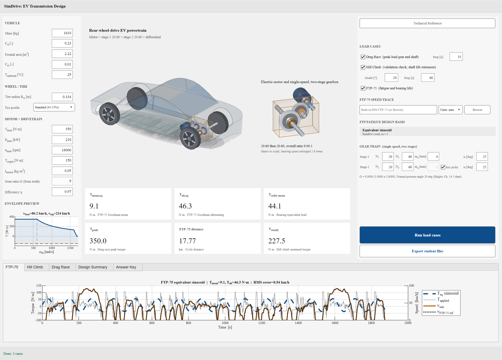
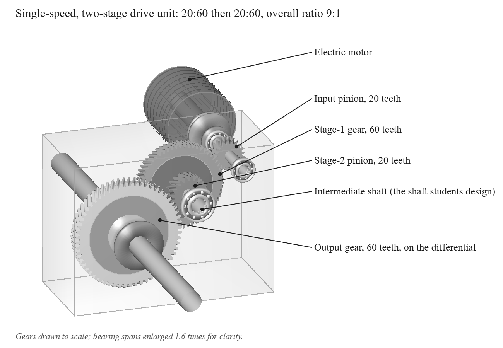
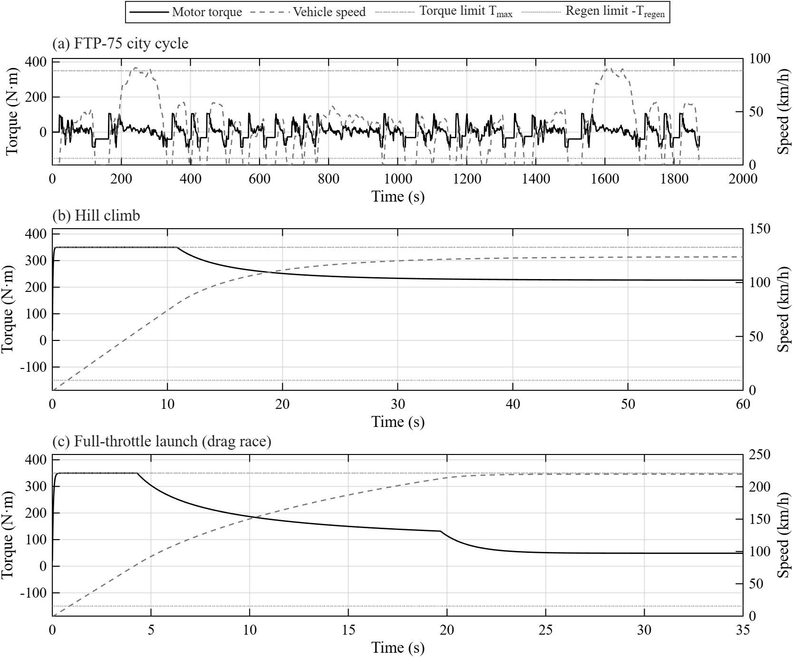

# SimDrive: EV Transmission Design
### Shigley-based gearbox design for a passenger EV, driven by Simulink load cases

[](https://www.mathworks.com/products/matlab.html)
[](LICENSE)

A machine design project for third- and fourth-year mechanical engineering
students, built on *Shigley's Mechanical Engineering Design*, 11th edition.
Students carry out the AGMA rating of two helical gear stages, the fatigue and
yield design of a stepped shaft, and the selection of deep-groove ball bearings
from a manufacturer's catalog. The loads come from a MATLAB and Simulink model
of the vehicle driving a full-throttle launch (the drag race case), the EPA
FTP-75 city cycle and a long hill climb.

The worked answer key is encrypted in this repository. Instructors can request
the password as described in [The reference solution](#the-reference-solution).



*The dashboard, shown with the answer key extracted; without it the "key picks"
box is off and the Answer Key tab stays empty.*

## The EV system at a glance

| Item | Value |
|---|---|
| Vehicle | Rear-wheel-drive passenger EV, 1610 kg, C<sub>d</sub> 0.23, frontal area 2.22 m², tire radius 0.334&nbsp;m |
| Motor | 350 N·m peak torque, 210 kW, 16,000 rpm speed limit (base speed 80 km/h, top speed 224 km/h) |
| Transmission | Single speed, two helical stages, 20:60 then 20:60, overall ratio 9:1, 20° normal pressure angle |
| What students design | Both gear meshes, the intermediate shaft that carries them, and its two bearings |
| Design life | 150,000 km |
| Targets | AGMA `S_F` ≥ 1.5 (bending), `S_H` ≥ 1.2 (contact); shaft factors of safety `n_f`, `n_y` ≥ 1.5 at every critical section |



## What the project adds

Each torque the students use comes from the vehicle model and belongs to a
different failure mode, and choosing the right one is part of the design. The
launch gives the peak torque that sizes the gear teeth and the static yield
check. The city cycle, reduced by rainflow counting, gives the mean and
alternating torques for the DE-Goodman shaft check and the cubic-mean torque for
bearing rating life (Shigley, Chapter 11). The hill climb gives a steady torque
that students use first to check the simulation by hand.

The hill climb is a synthetic, power-limited case. Its grade, 20 degrees by
default (a 36.4 percent grade), is steeper than a public road, chosen so that
the motor settles on its power limit and the steady torque has a closed-form
solution. The students' force balance agrees with the simulated value to within
one percent before they use any number from the model.

The templates and the reference solution follow the procedures of Shigley's 11th
edition, chapter by chapter, with the course approximations stated in the
[assignment scope](student/ASSIGNMENT_BRIEF.md#scope-and-limitations). Students
report where a passing course result falls short of a production transmission.

The answer key follows the instructor's choices. When the tooth counts, modules,
helix angles or the vehicle change, the dashboard recomputes the reference
solution for that gear train, so different sections or years can receive
different numbers from the same project.



## The mathematical model

The vehicle is modeled in Simulink as a point mass moving along a straight
road. Newton's second law balances the tractive force at the rear wheels against
rolling resistance, aerodynamic drag and the grade force, written here for the
motor driving the car:

```math
m_\text{eff}\,\frac{dv}{dt} = \frac{\eta\,G\,T_m}{R_w} - C_{rr}\,m\,g - \frac{1}{2}\,\rho\,C_d\,A\,v^2 - m\,g\sin\theta
```

The effective mass $m_\text{eff}$ adds the inertia of the motor rotor and the
four wheels, reflected through the overall ratio $G$ and the tire radius $R_w$.
The drivetrain efficiency $\eta$ is a constant 0.97 for the two meshes, and the
air density $\rho$ follows from the ambient temperature, pressure and humidity.
The motor torque $T_m$ is limited to the peak torque up to base speed and to
constant power above it, and it falls to zero just below the speed limit. On
the city cycle a discrete PID controller follows the FTP-75 speed schedule, and
its torque command passes through an actuator lag, a rate limiter and the motor
envelope before it reaches the vehicle. The launch and the hill climb run at
full throttle with no controller. The electrical side of the motor is not
modeled, since its time constants are a few milliseconds. Tire slip and thermal
derating are also left out, which makes the exported torques upper bounds on
what the gearbox would see.

## Summary of the methods

The torque histories are reduced on the instructor side before the students see
them. The city cycle is counted by rainflow (ASTM E1049), the small cycles
caused by controller ripple are dropped, and the remaining cycles are combined
by the Palmgren-Miner rule into one equivalent sinusoid: a mean torque and an
alternating torque that do the same fatigue damage as the full history. The
bearings use a different quantity, the cubic mean of the torque weighted by
shaft revolutions, which is the Shigley equivalent load for a load that varies
over the life of a bearing.

From these torques the students follow Shigley chapter by chapter. The motor
torque is carried to the intermediate and output shafts through the stage
ratios, and the tangential, radial and axial forces at each mesh follow from the
pitch diameter, the pressure angle and the helix angle (Chapter 13). Both stages
are rated for tooth bending and surface contact with the AGMA equations and
their rating factors (Chapter 14). The intermediate shaft is solved as a simply
supported beam in two planes, including the couples from the two helix thrusts,
and each critical section is checked for fatigue with the DE-Goodman equation
and for first-cycle yield with the von Mises stress (Chapters 3, 5, 6 and 7),
with the shoulder stress-concentration factors read from the Appendix A charts.
The bearings are then selected from a catalog by their equivalent radial load
and an L<sub>10</sub> rating life of 150,000 km (Chapter 11). The equations,
default parameters and their sources are given in full in
[`docs/MathematicalModels.md`](docs/MathematicalModels.md).

## What it covers from Shigley

| Shigley 11e chapter | Topic | Where students use it |
|---|---|---|
| 3 | Reactions, shear force and bending moment diagrams in two planes | Intermediate shaft |
| 5 | Distortion-energy theory for static failure | Shaft yield at the peak torque |
| 6 | Endurance limit, Marin factors, notch sensitivity, modified Goodman, S-N line | Shaft fatigue; finite life as an extension |
| 7 | Stepped shaft layout, critical sections, the DE-Goodman shaft equations | Intermediate shaft |
| 11 | Equivalent radial load and its factors, variable loading, L<sub>10</sub> rating life | Bearing selection |
| 13 | Helical gear geometry, force analysis, helix hand on a common shaft | Both gear stages and the shaft loads |
| 14 | AGMA bending and contact stress, every rating factor | Both gear stages |
| Appendix A | Stress-concentration charts, heat-treated steel properties | Shaft shoulders and materials |

## What students do

1. Load the data (`Student_01`). Match each torque to the failure mode it
   governs, carry it to the input, intermediate and output shafts, and check the
   hill-climb torque by hand.
2. Rate both gear stages (`Student_02`). Choose the face width, material and
   every AGMA factor with a stated source, and reach the bending and contact
   targets on all four gears.
3. Design the intermediate shaft (`Student_03`). Lay out a stepped shaft for
   minimum mass and check fatigue and yield at every critical section, including
   the two helix thrust couples.
4. Select the bearings (`Student_04`) from a manufacturer's catalog for 150,000
   km of rating life, and show a candidate that fails. The reference solution
   uses SKF.
5. Write the report, including at least one documented design iteration.

Optional extensions are the input shaft and a finite-life check: how many hours
of full-power hill climbing the shaft survives.

The templates give the method and the equations but no numbers. Every choice is
the student's to make and justify. The design is iterative, and what counts as a
good design depends on the constraints the instructor sets in the project
document.

## How to use it in a course

The full project fits a term, with each part released as its chapter is taught:
the gears after Chapters 13 and 14, the shaft after Chapters 6 and 7, the
bearings after Chapter 11. One part with a short report makes a two- to
three-week assignment, and the instructor guide explains how to
[scope the assignment](docs/INSTRUCTOR_GUIDE.md#scoping-the-assignment) with
upstream results handed out as given data. In lectures, the load cases show
where design loads come from. In a design review, students can argue which check
sizes each part and what that says about the assumptions behind it. Teams can
also print their gear train and defend it against their own numbers in the
[prototype challenge](docs/PROTOTYPE_CHALLENGE.md). What to assess is listed in
the [assessment guide](docs/ASSESSMENT_RUBRIC.md).

## Requirements

MATLAB R2025b or newer, Simulink, and the Signal Processing Toolbox (for
rainflow counting). The project is tested on R2025b and R2026b on Windows and
has not yet been tested in MATLAB Online. Run `check_dependencies` in
`instructor/` on a new machine. Chapter references follow the 11th edition of
*Shigley's Mechanical Engineering Design*.

## Quick start

```matlab
% In MATLAB, from the repository folder
cd instructor
Start_Here            % checks the installation and opens the dashboard
```

In the dashboard, keep the defaults or set your own car and gear train, press
**Run load cases** (about two minutes for all three cases on a desktop PC), then
**Export student files**. Hand students the `student_package/` folder or the
student ZIP attached to the v1.0.0 release (the dashboard also writes it to
`release/` on your computer). It holds the project brief, the four templates,
the simulation data and the student documents. The worked solution is not
included.

The mass, drag, tire, motor torque, power and speed limit, and the teeth,
modules and helix angle of both stages are all inputs. The dashboard refuses a
gear train outside the range of Shigley's charts and gives the reason. To give
different sections different numbers, vary the gear train or the vehicle.

From the command line instead, run `generateLoadCases` in `instructor/` (it
clears the base workspace), then `buildStudentPackage`. More detail is in
[`docs/QUICKSTART.md`](docs/QUICKSTART.md) and the
[instructor guide](docs/INSTRUCTOR_GUIDE.md).

## The reference solution

A complete worked solution and the reference results ship in an encrypted
archive, `instructor_answer_key.7z` (AES-256), so that students who find this
repository cannot read them. The student package never contains them.

To obtain the password, email Dr. Ahmed Hanafy Ibrahim at
[ahmedibrahim@aus.edu](mailto:ahmedibrahim@aus.edu?subject=SimDrive%20answer%20key%20request)
from your institutional email address, with your name, institution and the
course you teach.

Extract the archive in the repository folder (7-Zip, or
`7z x instructor_answer_key.7z`), and the dashboard then computes the answer key
for every export and writes `exports_design_ready/Answer_Key.md`. Everything
else, including the dashboard and the student package, works without the
password.

The solution is one valid design among several. How to use it in grading is
described in [`instructor/solution/README.md`](instructor/solution/README.md).

## Limitations

The project is a teaching model. Its main simplifications, each stated to
students, are these:

- A point-mass vehicle with constant drivetrain efficiency, no tire slip and no
  thermal derating.
- The gear quality number is checked at 120 km/h; near top speed the stage-1
  pinion would run faster than Shigley's dynamic-factor chart covers.
- Press fits and keys are assumed to add no stress concentration.
- Bearing life is the 90 percent `L10` rating life, with no reliability or
  application factor.
- The reference solution takes the AGMA size factor as 1, which Shigley permits.

The full list is in [`docs/MathematicalModels.md`](docs/MathematicalModels.md).

## Feedback

Please [open an issue](https://github.com/ahmedibrahim-aus/SimDrive-EV-transmission/issues)
to tell us which parts you assigned and what your students found hard, or to
report a problem. See [`CONTRIBUTING.md`](CONTRIBUTING.md).

## Authors

**Dr. Ahmed Hanafy Ibrahim**, Assistant Professor, American University of
Sharjah (ahmedibrahim@aus.edu), corresponding author. **Mahmoud Al Herbawi** and
**Malek Zahir**, senior undergraduate students.

## Acknowledgements

This work was financially supported by [MathWorks](https://www.mathworks.com)
through the MathWorks Teaching Support Award. We used the
[MATLAB Agentic Toolkit](https://github.com/matlab/matlab-agentic-toolkit) with
Claude Code in the testing and development of the instructor dashboard, where it
helped assess edge cases and improve the computational efficiency of the code.

## License

Software: BSD-3-Clause ([`LICENSE`](LICENSE)). Course materials and
documentation: CC BY-SA 4.0 ([`LICENSE-docs`](LICENSE-docs)).

## Citation

```bibtex
@misc{ibrahim2026simdrive,
  author    = {Ibrahim, Ahmed Hanafy and Al Herbawi, Mahmoud and Zahir, Malek},
  title     = {{SimDrive: EV Transmission Design}},
  version   = {1.0.0},
  year      = {2026},
  publisher = {GitHub},
  url       = {https://github.com/ahmedibrahim-aus/SimDrive-EV-transmission}
}
```

## References

1. Budynas, R. G., and Nisbett, J. K. *Shigley's Mechanical Engineering Design*,
   11th ed. McGraw-Hill, 2020.
2. ANSI/AGMA 2101-D04. *Fundamental Rating Factors and Calculation Methods for
   Involute Spur and Helical Gear Teeth*.
3. SKF Group. *Rolling bearings*, PUB BU/P1 17000/1 EN. 2021.
4. US EPA. *Federal Test Procedure (FTP-75) urban dynamometer driving schedule*.
5. Gillespie, T. D. *Fundamentals of Vehicle Dynamics*. SAE International, 1992.
6. ASTM E1049-85 (2017). *Standard Practices for Cycle Counting in Fatigue
   Analysis*.
